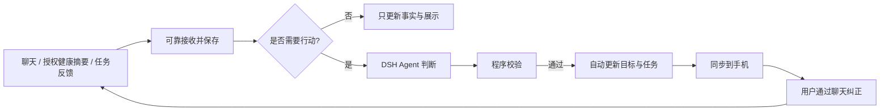

<p align="center">
  
</p>

<h1 align="center">Along</h1>

<p align="center">
  <b>你的目标，陪你一步步实现</b><br>
  从目标到行动，Along 帮你分析拆解、持续追踪，并随着进展实时调整方向，直到达成目标。
</p>

<p align="center">
  <a href="https://artstur.github.io/along/"></a>
  = 22.19">
  
  
  
</p>

<p align="center">
  <a href="#快速开始">快速开始</a> ·
  <a href="#它是怎么工作的">工作原理</a> ·
  <a href="#连接-agent">连接 Agent</a> ·
  <a href="ios/README.md">iPhone App</a> ·
  <a href="#开发与发布">开发与发布</a>
</p>

---

## 为什么是 Along

大多数目标写下来就静止了：「本周运动 120 分钟」挂在那里，你得自己算还差多少、今天该做什么、计划被打乱后怎么补。

Along 把一个目标拆成三样东西，并让它们保持联动：

| | 是什么 | 例子 |
| --- | --- | --- |
| **目标** | 你想达成的结果 | 本周累计运动 120 分钟 |
| **动态任务** | 根据进度算出来的下一步 | 「本周只差 35 分钟，找一个活动时段」 |
| **连接数据源** | 页面底部与目标有关的真实数据 | Apple Health 的本周健身记录 |

任务卡展示执行时间、定时任务标记和查看详情。推荐方案归入对应任务详情，详情显示可核实的执行次数与记录；提醒排队不等于实际动作完成。实现与验收见 [动态任务详情](docs/task-detail-layout.md)。

新架构中，来源变化先更新事实，足以影响安排时才交给 Agent 判断；目标与任务经程序校验后自动生效，你通过聊天纠正。普通变化只在目标里展示，需要你回答、近期安排有实质变化或执行受阻时才通知。

## 新架构与实现状态

阶段 C 已接入健康事件自动跟进：在目标页授权所选 Apple Health 摘要后，iPhone 在前台及系统允许的后台机会自动补传；服务端按目标筛选变化并建立评估工单，经校验调整任务。无须再发聊天，也无采用步骤。原始样本仍留在手机。设计与验收见 [阶段 C](docs/stage-c-tech-design.md)。

Along Host 负责配对与协议代理，Along Agent（基于 DSH Super Agent）保存业务状态并执行编排；iPhone 提供聊天、授权摘要、离线缓存和待同步队列。新事件链路可在 Mac 本机或启用事件接入的云端栈运行。两种形态及验收入口见[架构与开发入口](docs/agent-architecture.md)。

已确定的交互边界：

- **明确行动意图才自动建目标**。例如「我想改善睡眠」可直接建立目标；「最近睡得不好」先回应，仅在缺少意图时询问，不把现象直接变成目标。
- **校验后自动生效，通过聊天纠正**。不设采用、确认或审批环节，界面不提供直接编辑或删除目标的入口。
- **按需要通知**。普通变化只在目标里展示；需要你回答、近期安排有实质变化或执行受阻时才通知。通知仍受 iOS 权限与执行机会限制。
- **忘记不删除历史聊天**。撤回对应记忆，立即停止将其作为有效记忆使用，并清理派生记忆与索引；历史聊天保留，不能从旧聊天重新提取并复活已撤回的记忆。不因此自动取消目标或重排已有任务。

- **多目标由 Agent 协调**。优先遵守你明确的优先级和硬约束，其余自动协调；无法同时满足硬约束时才询问。
- **首期按本人自用简化**。不做额外的健康授权撤回及关联历史数据清理流程，系统数据不可用时仍正常处理。
- **不设应用侧模型用量上限**。不设每日预算或累计调用额度；批量作业、超时和失败重试仍按技术方案运行。

启用事件接入后，App 自动协商使用 Along Agent。旧 Host 保留双运行时和采用相关流程；云端 Tier 1 的 DSH Runner 也能自动应用经校验的目标对话结果，但不提供事件工作区。Linux 云端已记录一轮真实模型建目标与容器重建持久化验证，这不等于个人工作区交接、自然健康补传或通知送达均已验收。

## 能体验什么

以下演示入口属于旧 Host 兼容路径；新事件链路由 Along Agent 自动维护目标，不显示采用或直接编辑入口。

顶部下拉即可在目标之间切换。一屏只做一件事：看清进度，知道下一步。

| 目标 | 数据从哪来 | 你能看到 |
| --- | --- | --- |
| **健康** · 本周累计运动 120 分钟 | iPhone App 连接 Apple Health；普通网页可选演示数据 | 按所选摘要计算进度与下一步，连接页可一键选择全部可读指标 |
| **理财** · 三个月存下 ¥10,000 应急金 | 纯演示：点「体验连接」出现 ¥3,200 余额 | 「模拟 +¥800」后进度与任务文字随之更新 |
| **＋ 定义新目标** | 你用自然语言描述期限、偏好和约束 | Agent 分析与综合；首次结果完整时自动创建，后续调整通常仍待采用 |

此外还有两处值得一看：

- **动态任务详情**：点任意任务卡片，进入真实的 DSH Super Agent 协作视图，看到 Trigger → Eval → Ticket → Assignment，以及 Main Session、Worker Session、Report 与 Mandate。进度来自 DSH 的持久化状态，不是本地计时器。
- **目标变化实验**：健康目标页底部，固定 75 + 35 分钟场景，展示 Along 怎样计算、判断路由并给出建议；轻微或无关的变化保持安静。

> [!NOTE]
> 上述理财示例仍用演示数据。真实目标中的 OKX 由 iPhone 原生验证只读权限、采集交易账户摘要及有界的近三个月成交、账单，凭证只存本机钥匙串；Host 保存私有规范化明细，计算分币种费用与普通交易收益分量，再通过来源能力交给 Agent 按目标读取。不支持转账或交易。见 [设备采集通用规则](docs/device-data-sources.md)。

## 它是怎么工作的

新事件链路的目标流程（聊天与健康跟进已实现，真机验收边界见阶段 B/C）：



以下为旧 Host 兼容路径的具体行为（新事件链路见上文及阶段 B/C）：

- **手机整理观察数据**。Apple Health 提供已选指标的汇总。运动摘要同时保留本周进度、最近两个完整七日的记录总量和最近四周的时段分布。在 iPhone 预览并确认后，睡眠与体重也可比较两个七日。每段都标明有记录的天数。
- **Agent 判断要不要调整计划**。新观察、目标反馈和到期复查会连同已有任务提交给所选运行时。Agent 可维持原计划、提出逐项更改，或提出一个需要用户回答的问题。健康计划中的「动态任务 → 补充信息」可直接告诉 Agent 想做什么，包括按近期作息安排一次定时提醒。
- **每日行动由 DSH 规划**。在健康目标的「补充信息」明确委托每天提醒睡觉和运动后，睡眠卡显示今天的睡前准备提醒和可选的就寝建议，运动卡显示当天建议的分钟及提醒时间。周目标仍保留。点卡片可查看依据和真实工单；“iPhone 已安排”来自 iOS 待发队列。说“停止每日提醒”可以撤回委托。
- **Agent 输出先校验**。结果先过 `validateGoalReply` 与 `safeAdaptiveLayout`，绑定可信指标后再渲染。首次自定义目标在结果完整时自动创建，已有目标的调整仍有采用流程；新架构将统一为校验后自动生效。
- **可执行结果会进系统通知**。iPhone 上第一次把目标或动态任务交给 Agent 时请求通知权限；编排完成且结果中确实有“下一步”后才发通知。相同 Request ID 只发一次，点通知回到对应目标或任务。

## 快速开始

健康情境可用广州样本回放。`node examples/guangzhou-health-replay.mjs` 输出完整合成数据集，加上 `--stage short-sleep` 或 `--stage friday-weekend` 会生成与手机同格式的请求。每个阶段只使用当时已出现的睡眠、运动和外部材料。输出请求不会调用 Agent 或排入通知。

### 只想看看

直接打开 [在线体验](https://artstur.github.io/along/)。健康和理财示例都能在纯网页里用演示数据跑通。

### 本地运行

真机连接新架构，在仓库根目录执行：

```sh
npm install
npm run activate
```

它会构建相邻的 `../along-superagent` 和 App 内置页面，首次创建独立的 `along-phone` DSH profile，初始化新链路并启动 DSH 与 Along Host。优先复用桌面 DSH 的模型设置；缺少模型配置或 API Key 时在终端询问，Key 隐藏输入并仅保存在 Mac 的 0600 凭证文件中，后续免输。终端会打印手机所需的地址、指纹和连接码，Ctrl+C 关闭本次服务。数据在 `~/.along/phone-test/`，重跑沿用原数据；iPhone 仍需在 Xcode 安装和授权。首次需要本机已有 DSH、Node/npm 与 pnpm，且 Along 已运行 `npm install`。详情见[一条命令激活](docs/stage-b-tech-design.md#一条命令激活本机服务2026-11-16)。

```sh
npm install        # 会安装项目自带的 Node 22.23.4
npm run dev        # http://localhost:4173，仅监听 127.0.0.1
```

没有打包器：`web/` 就是前端唯一源码，改完刷新即可。

### 连接 Agent

下述为旧 Host 兼容接入；新事件链路使用上面的 `npm run activate`。

「定义新目标」和任务提案需要在 Mac 上运行 Along Agent Host。目标页可以在两种运行时之间切换，两者的运行记录相互隔离；没选过时默认用 Kimi。

<details open>
<summary><b>Kimi Swarm</b>：需要 Kimi Code 2.5.0 或更新版本</summary>

```sh
curl -fsSL https://code.kimi.com/kimi-code/install.sh | bash
kimi                                  # 输入 /login 完成登录后退出
kimi web --no-open --port 58627       # 启动本机 Web Server
npm run agent-host
```

Agent Host 只从 Mac 本机读取 `~/.kimi-code/server.token`，不会把它发给 iPhone，也不会写进运行结果。Kimi 未登录或 Web Server 未运行时，只有 `Kimi Swarm` 显示不可用，`DSH Agents` 可继续使用。

</details>

<details>
<summary><b>DSH Agents</b>：需要本机 DSH Super Agent</summary>

先启动 DSH Super Agent（默认 `http://127.0.0.1:3082`）并加载 Along Source，然后：

```sh
npm run agent-host
```

Along 本地部署启用 Along Source 并关闭 GitHub Source，不需要 GitHub 账号。另行配置 GitHub 部署时，账号用于分支、提交和 PR 交付，默认不自动合并。

</details>

### 和 iPhone 配对

本机使用 `npm run activate`（事件工作区）或 `npm run agent-host`（默认兼容模式）时，使用终端给出的三项信息：

```text
局域网 HTTPS 地址     https://192.168.x.x:4176
证书 SHA-256 指纹     AB:CD:...
一次性配对码          15 分钟内有效
```

在 iPhone App 的配对入口填写这三项，并确保手机可访问 Mac（例如同一 Wi-Fi）。云端新配对使用部署提供的 HTTPS 地址、一次性配对码和对应的系统信任策略；系统信任入口不填叶指纹。已有个人事件工作区要保留历史、待发与提醒时，不要直接换址或重新配对，走[受保护的冷交接](docs/personal-workspace-handoff.md)。

iPhone App 的签名、安装与 HealthKit 读取口径见 [ios/README.md](ios/README.md)。

## 配置

所有变量都有默认值，一般无需设置。服务端状态目录：直接 `npm run agent-host` 在 `~/.along/agent-host/`，`npm run activate` 在 `~/.along/phone-test/`，云端部署在挂载卷 `/opt/along/data/host`（云端部署变量见 `deploy/env.example` 与 [云端部署与多用户](docs/cloud-deploy-multi-user.md)）。

| 变量 | 默认值 | 作用 |
| --- | --- | --- |
| `PORT` / `HOST` | `4173` / `127.0.0.1` | `npm run dev` 本地服务 |
| `ALONG_AGENT_PORT` | `4176` | Agent Host 的 HTTPS 端口 |
| `ALONG_AGENT_HOST` | `en0` 的 IPv4，取不到时为 `127.0.0.1` | Agent Host 绑定地址 |
| `ALONG_AGENT_STATE_DIR` | `~/.along/agent-host` | 服务端状态目录（配对绑定、用户表、每日委托、Kimi 运行记录等） |
| `ALONG_SUPERAGENT_URL` | `http://127.0.0.1:3082` | DSH Super Agent 地址 |
| `ALONG_EVENT_INGEST` | `off` | `on` 启用新聊天链路；App 自动协商，停止旧 DSH 写入 |
| `ALONG_BRIDGE_TOKEN_FILE` | 未设置 | Along Agent 的 `alongBridgeTokenFile` 对应文件绝对路径；凭证只在服务端两个进程间传递 |
| `ALONG_KIMI_CODE_URL` | `http://127.0.0.1:58627` | Kimi Code Web Server 地址 |
| `ALONG_KIMI_CODE_TOKEN` | 读取 `~/.kimi-code/server.token` | 覆盖 Kimi token |
| `ALONG_KIMI_CODE_MODEL` | `kimi-code/kimi-for-coding` | Kimi 模型 |
| `ALONG_KIMI_WORKSPACE` | 当前目录 | Kimi 会话工作目录 |
| `ALONG_CONTEXT_REVIEW_URL` | 同 DSH 服务地址 | 专用健康情境评估服务 |
| `ALONG_CONTEXT_REVIEW_TOKEN_FILE` | 未设置 | 本机情境评估服务的凭据文件 |
| `CODEX_BIN` | `~/.local/bin/codex`，否则 PATH 中的 `codex` | 健康变化任务提案使用的 Codex |
| `ALONG_TLS_DAYS` / `ALONG_TLS_CN` | `30` / `Along Local Agent` | 本地自签证书的天数与 CN，只在生成证书时生效。云端形态不再自签：`ALONG_TLS_CN` 是期望的 DNS 主机名，Host 读状态目录里预签发的 CA 叶证书（`tls/current`），缺证或不合规则监听前拒启（[CA 方案](docs/iphone-ca-profile-design.md)） |
| `ALONG_DSH_RUNNER_URL` | 未设置 | 设置后 DSH 分支走云端 Runner，Host 启动前要求有效的 `users.json`；未设置走 Mac 本地 bridge |
| `ALONG_RUNNER_TOKEN_FILE` | 未设置 | runner 内网令牌文件；设置了 `ALONG_DSH_RUNNER_URL` 就必须配，缺失拒绝启动 |
| `ALONG_PAIR_FAIL_LIMIT` | `10` | 公网配对失败窗口上限，按来源（连接 IP）分桶计数。某来源满窗时对该来源停止验码，可将上限调低 |

## 隐私与安全

Along 处理的是健康这类敏感数据，所以边界写得很死：

| 原则 | 具体做法 |
| --- | --- |
| 授权的数据范围 | 旧授权限于已选的周运动总时长。确认导入情境评估后，Agent 可收到所选健康类型的汇总、当前计划、观察变化和近期反馈 |
| 健康数据范围 | 新事件链路在已配对的服务端保存授权摘要，手机保存本地摘要及待同步事件；原始 HealthKit 样本仍留在手机 |
| 凭证只留服务端 | Kimi、模型、桥接、APNs 凭证只保存在服务端安全存储（Mac 或云主机的卷/secrets/env），绝不发给 iPhone 或网页，也不写进运行结果和日志；配对 token 只在配对响应出现一次，服务端只存哈希 |
| 部署面收敛 | Mac 本地模式默认不发布公网入口。基础云端 Compose 对外只开放 443 一个端口提供 Along 服务；公共 IP 叠加另开放 80 用于 HTTP-01。其他实测入口见[部署说明](deploy/README.md)。云端配对码另有按来源（连接 IP）失败限速 |
| TLS 信任 | Mac 私网：服务端启动时现场自签，iPhone 原生网络层校验叶指纹后才传输。云端：服务端读预签发的 CA 叶证书；若由 nginx 终止公网 TLS，手机校验 nginx 的证书。iPhone 按系统信任评估校验链/主机名/有效期，公网 IPv4 核对 IP SAN。仅私有 CA 需要安装根描述文件并开启完全信任（[CA 方案](docs/iphone-ca-profile-design.md)） |
| 通过聊天纠正 | 新事件链路与云端目标聊天的变更经校验后自动生效。Mac 旧兼容链路保留原有采用流程 |
| 忘记与历史分开 | 新架构中「忘记这件事」撤回对应记忆，不删除历史聊天；旧聊天不能重新激活已撤回的记忆 |

连接凭证的哈希只保存在服务端状态目录的 `pairings.json`（每用户一条；本地模式在 `~/.along/agent-host/` 或 `~/.along/phone-test/host/`，云端在 `/opt/along/data/host`），连接信息同时保存在 iPhone Keychain。

## 项目结构

```text
.
├── web/                                   # 前端唯一源码（保持平铺）
│   ├── index.html  app.mjs  style.css     # 页面与交互
│   ├── sw.js  manifest.webmanifest        # 离线缓存与 PWA
│   ├── health.mjs  loop.mjs               # 目标进度、健康摘要与变化循环
│   ├── workspace.mjs  adaptive-ui.mjs     # 目标空间与自适应布局校验
│   ├── goal-agent-core.mjs                # Agent 回复解析、路由与校验
│   └── super-agent.mjs  agent-client.mjs  # 运行时定义与前端 Agent 客户端
├── host/                                  # Mac 和云端共用的服务源码
│   ├── agent-host.mjs                     # HTTPS Agent Host
│   ├── kimi-code-agent.mjs  codex-agent.mjs # 各 Agent 运行时适配
│   ├── server.mjs                         # npm run dev 本地服务
│   └── schemas/                           # Agent 输出的 JSON Schema
├── test/                                  # *.test.mjs，npm run check 自动运行
├── tools/                                 # build.mjs 构建脚本
├── ios/                                   # iPhone App（HealthKit + WKWebView）
└── deploy/                                # 云端部署入口
```

`host/` 会从 `../web/` 引用共享校验逻辑，所以这些共享文件必须同时能在浏览器和 Node 里运行。

## 开发与发布

```sh
npm run check   # CI 同款：语法检查 + 全部测试
npm run build   # 产出 dist/（GitHub Pages）与 ios/AlongHealth/Web/（App 内置页面）
```

新增前端文件或更新资源版本时，按[项目约定](AGENTS.md)第 2 节同步构建白名单、离线缓存与 iOS 壳。第 3 节列出 CI 检查的范围。

**推送 `main` 不会自动部署：**

- GitHub Pages：手动触发工作流（GitHub Actions → Deploy GitHub Pages → Run workflow，或 `gh workflow run pages.yml --ref main`），依次执行 `npm ci`、`npm run check`、`npm run build` 并发布 `dist/`。
  工作流固定使用 `macos-15-intel`，在 ARM macOS 队列容量不足时保留真实 Swift/Keychain 回归。执行机排队或分配失败不代表页面已部署；以 Pages 成功回执与线上资源比对为验收依据。
- iPhone：先 `npm run build`，再在 Xcode 里重新构建并安装。

## 新协议任务通知与到期复查

iPhone 在已同步的任务到点时提醒。Mac 上的 Agent 得出需要告知的推荐或执行结果后，通过通知引导用户回到对应目标和任务。一次性提醒只执行一次，每日续排使用用户已表达的持续委托。复查以持久事件和工单为准，缺少新摘要时可以等待或询问。

- Agent 在既有同步项的 `payload.notification` 标记已生效且需要告知的结果，包括稳定 `event_id`、`kind`（`recommendation_ready` 或 `task_result`）和 `revision`。归属使用该同步项的 `goalId`、可选 `taskId` 和配对用户。普通执行进度和 keep 保持安静，旧版仍能消费同步页。
- iPhone 从通过校验的有效任务快照维护本地系统队列。授权的设备通过原有固定证书的配对连接向 `POST /notifications/device` 发送 `{token,environment,expectedUserId}`（development 或 production），撤权发送 `{enabled:false,expectedUserId}`。宿主单独消费 Agent 的持久同步记录，iPhone 挂起时仍可将新结果发送至 APNs。远程开启状态随同步页返回；缺少远程能力时，已授权手机在前台同步可补收近期结果。
- Host 使用专属于 Along 的 Apple APNs 令牌签名密钥。为 Host 进程设置 `ALONG_APNS_KEY_FILE`（私有 P-256 .p8，0600）、`ALONG_APNS_KEY_ID` 和 `ALONG_APNS_TEAM_ID`。App 标识为 `com.artstur.along`。开发和生产设备使用各自签名环境，发布包应具备对应的 aps-environment。设备令牌和签名材料留在私有目录，通知正文只提示用户打开 Along 阅读。
- 验收覆盖重复同步、改期和取消、授权与配对切换、服务重启、失败重试、实际复评及跨日续排。iOS 系统接受排程、通知中心实际送达、点开定位分别记录。远程送达需要有效签名与 provider，并单独在 App 挂起时验证。

已取得的 iOS 系统排程回执通过 `POST /notifications/scheduled` 回传。Agent 为到点的任务产生 `reminder_due`，Host 遇到同一目标、任务和触发时刻已有本地回执时抑制远程副本。用户一直未打开 App 时，Mac 次日才生成的安排可在到点走 APNs。手机完全离线期间，系统仍可能展示断线前已经预约的旧时刻，重连后按当前任务校准。

Host 逐事件保存待发记录。APNs 拒收或短时失败后，已授权 iPhone 下次拉取同步页也能接手近期推荐，即使业务游标已经前进；原生处理后返回回执。到期提醒的远程补送及结果交接只在十分钟有效期内重试。提供方接受请求和设备确实展示分别验收。

## 当前边界

坦白说，这还是一个 Demo，下面这些是有意为之或尚未完成的：

- **健康更新按授权触发**。锁屏读取、系统唤醒与网络可达仍受环境限制，真机边界见[阶段 C](docs/stage-c-tech-design.md)。旧 Host 的逐目标后台评估是兼容流程。
- **通知由 iOS 处理**。新事件链路维护已同步任务的本地预约，明确的推荐与任务结果可走配对通知通道；普通进度和 keep 保持安静。APNs 需要对应签名与 Host 配置，预约成功、提供方接单、设备展示与点开应分别验收，详见[新协议通知](#新协议任务通知与到期复查)。旧 Host 仍保留采用后的提醒兼容流程。
- **新一轮 Agent 处理依赖配对 Host 和运行时可达**。本机模式依赖 Mac，云端模式不要求 Mac 在线。断网仍可读已保存内容；事件工作区的待发数据待连接恢复后同步。GitHub Pages 是静态站，不运行 Agent。
- **OKX 支持 iPhone 只读历史复盘**。其他理财示例仍为演示。原生采集近三个月有界成交与账单，保留完整/截断/不可用覆盖状态；Agent 可读取分币种费用和实际普通交易分量，策略归属与完整收益仍依赖真实成本、规则和数据覆盖。见[历史契约](docs/okx-trade-history.md)。不转账、不交易。
- **个人团队签名**。Xcode 个人团队的配置文件通常 7 天后到期，需要重新构建安装。

## 相关文档

- [文档索引](docs/README.md)：按当前实现、设计、历史验收和开发流程查阅
- [架构与开发入口](docs/agent-architecture.md)：两工程分工、实现状态与交互边界
- [iPhone 开发与安装](ios/README.md)：原生运行步骤、HealthKit 范围和数据口径
- [项目约定](AGENTS.md)：参与开发前必读的构建、校验和隐私边界


### 目标聊天与后台编排

“聊聊这个目标”只显示用户本人的直接对话和 Agent 的直接答复。提醒补齐、健康跟进、续排和开发执行留在后台；需要用户回答的必要问题仍按原目标交互。后台生成的推荐在目标已有推荐区展示，点通知回到方案，选择“聊聊这个方案”后可向 Agent 反馈。内部工作记录不会伪装成用户发言。

宿主按真实来源维护消息 audience；旧客户端升级后首次前台同步会分页补齐历史分类，保留目标、任务、原提醒与草稿。离线旧缓存不做猜测删除；已存内部记录在完成该同步后从 chat 移除。开发与验收只使用隔离身份，正式维护沿宿主内部 ChangeSet 或健康/到期通道执行，不经正式用户聊天代发消息。
