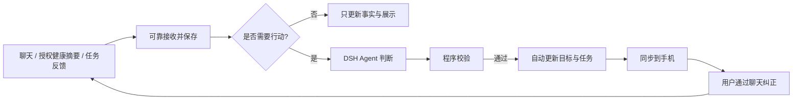

<p align="center">
  
</p>

<h1 align="center">Along</h1>

<p align="center">
  <b>你的目标，陪你一步步实现</b><br>
  从目标到行动，Along 帮你分析拆解、持续追踪，并随着进展实时调整方向，直到达成目标。
</p>

<p align="center">
  <a href="https://artstur.github.io/along/"></a>
  = 22.19">
  
  
  
</p>

<p align="center">
  <a href="#快速开始">快速开始</a> ·
  <a href="#它是怎么工作的">工作原理</a> ·
  <a href="#连接-agent">连接 Agent</a> ·
  <a href="ios/README.md">iPhone App</a> ·
  <a href="#开发与发布">开发与发布</a>
</p>

---

## 为什么是 Along

大多数目标写下来就静止了：「本周运动 120 分钟」挂在那里，你得自己算还差多少、今天该做什么、计划被打乱后怎么补。

Along 把一个目标拆成三样东西，并让它们保持联动：

| | 是什么 | 例子 |
| --- | --- | --- |
| **目标** | 你想达成的结果 | 本周累计运动 120 分钟 |
| **来源** | 与这个目标有关的真实数据 | Apple Health 的本周健身记录 |
| **动态任务** | 根据进度算出来的下一步 | 「本周只差 35 分钟，找一个活动时段」 |

新架构中，来源变化先更新事实，足以影响安排时才交给 Agent 判断；目标与任务经程序校验后自动生效，你通过聊天纠正。普通变化只在目标里展示，需要你回答、近期安排有实质变化或执行受阻时才通知。

## 新架构与实现状态

新方案以 [Along 本地 Agent 系统架构](https://github.com/artstur/along-superagent/blob/feature/along-phase0/docs/along/001-architecture.md) 为准：首期自用，Mac 上运行 Along Host、DSH fork 与 Hy-Memory，iPhone 提供聊天和授权健康摘要。Mac 保存业务状态，手机保留离线缓存与待同步事件。复盘、记忆提取和 Skill 整理由定时作业批量处理。

已确定的交互边界：

- **明确行动意图才自动建目标**。例如「我想改善睡眠」可直接建立目标；「最近睡得不好」先回应，仅在缺少意图时询问，不把现象直接变成目标。
- **校验后自动生效，通过聊天纠正**。不设采用、确认或审批环节，界面不提供直接编辑或删除目标的入口。
- **按需要通知**。普通变化只在目标里展示；需要你回答、近期安排有实质变化或执行受阻时才通知。通知仍受 iOS 权限与执行机会限制。
- **忘记不删除历史聊天**。撤回对应记忆，立即停止将其作为有效记忆使用，并清理派生记忆与索引；历史聊天保留，不能从旧聊天重新提取并复活已撤回的记忆。不因此自动取消目标或重排已有任务。

- **多目标由 Agent 协调**。优先遵守你明确的优先级和硬约束，其余自动协调；无法同时满足硬约束时才询问。
- **首期按本人自用简化**。不做额外的健康授权撤回及关联历史数据清理流程，系统数据不可用时仍正常处理。
- **不设应用侧模型用量上限**。不设每日预算或累计调用额度；批量作业、超时和失败重试仍按技术方案运行。

本轮方案与验证记录保存在 `along-superagent` 的 `feature/along-phase0` 分支，上述链接指向该分支。

**阶段 A 基座与阶段 B 最小聊天闭环已有实现，尚未完成真机验收。** Host 开启新事件链路后，App 自动协商使用 DSH：原话可靠入队，目标和任务在校验后自动生效，页面同步展示，你通过聊天纠正。这条链路没有采用、直接编辑或删除入口。健康新协议、长期记忆宿主接线及批量复盘仍待实现。旧 Host 兼容路径继续使用下文描述的双运行时和采用流程；旧手机数据保留，本轮不自动导入新库。范围、配置和验收见 [阶段 B 设计](docs/stage-b-tech-design.md) 与 [实施与验收](https://github.com/artstur/along-superagent/blob/feature/along-phase0/docs/along/003-implementation.md)。

## 能体验什么

顶部下拉即可在目标之间切换。一屏只做一件事：看清进度，知道下一步。

| 目标 | 数据从哪来 | 你能看到 |
| --- | --- | --- |
| **健康** · 本周累计运动 120 分钟 | iPhone App 连接 Apple Health；普通网页可选演示数据 | 按所选摘要计算进度与下一步，连接页可一键选择全部可读指标 |
| **理财** · 三个月存下 ¥10,000 应急金 | 纯演示：点「体验连接」出现 ¥3,200 余额 | 「模拟 +¥800」后进度与任务文字随之更新 |
| **＋ 定义新目标** | 你用自然语言描述期限、偏好和约束 | Agent 分析与综合；首次结果完整时自动创建，后续调整通常仍待采用 |

此外还有两处值得一看：

- **动态任务详情**：点任意任务卡片，进入真实的 DSH Super Agent 协作视图，看到 Trigger → Eval → Ticket → Assignment，以及 Main Session、Worker Session、Report 与 Mandate。进度来自 DSH 的持久化状态，不是本地计时器。
- **目标变化实验**：健康目标页底部，固定 75 + 35 分钟场景，展示 Along 怎样计算、判断路由并给出建议；轻微或无关的变化保持安静。

> [!NOTE]
> 理财目标只用演示数据，没有接入蚂蚁财富或任何真实账户，不读取账户，也不转账或交易。

## 它是怎么工作的

新架构的目标链路（待实现）：



当前实现的具体行为（迁移前）：

- **手机整理观察数据**。Apple Health 提供已选指标的汇总。运动摘要同时保留本周进度、最近两个完整七日的记录总量和最近四周的时段分布。在 iPhone 预览并确认后，睡眠与体重也可比较两个七日。每段都标明有记录的天数。
- **Agent 判断要不要调整计划**。新观察、目标反馈和到期复查会连同已有任务提交给所选运行时。Agent 可维持原计划、提出逐项更改，或提出一个需要用户回答的问题。健康计划中的「动态任务 → 补充信息」可直接告诉 Agent 想做什么，包括按近期作息安排一次定时提醒。
- **每日行动由 DSH 规划**。在健康目标的「补充信息」明确委托每天提醒睡觉和运动后，睡眠卡显示今天的睡前准备提醒和可选的就寝建议，运动卡显示当天建议的分钟及提醒时间。周目标仍保留。点卡片可查看依据和真实工单；“iPhone 已安排”来自 iOS 待发队列。说“停止每日提醒”可以撤回委托。
- **Agent 输出先校验**。结果先过 `validateGoalReply` 与 `safeAdaptiveLayout`，绑定可信指标后再渲染。首次自定义目标在结果完整时自动创建，已有目标的调整仍有采用流程；新架构将统一为校验后自动生效。
- **可执行结果会进系统通知**。iPhone 上第一次把目标或动态任务交给 Agent 时请求通知权限；编排完成且结果中确实有“下一步”后才发通知。相同 Request ID 只发一次，点通知回到对应目标或任务。

## 快速开始

健康情境可用广州样本回放。`node examples/guangzhou-health-replay.mjs` 输出完整合成数据集，加上 `--stage short-sleep` 或 `--stage friday-weekend` 会生成与手机同格式的请求。每个阶段只使用当时已出现的睡眠、运动和外部材料。输出请求不会调用 Agent 或排入通知。

### 只想看看

直接打开 [在线体验](https://artstur.github.io/along/)。健康和理财示例都能在纯网页里用演示数据跑通。

### 本地运行

```sh
npm install        # 会安装项目自带的 Node 22.23.4
npm run dev        # http://localhost:4173，仅监听 127.0.0.1
```

没有打包器：`web/` 就是前端唯一源码，改完刷新即可。

### 连接 Agent

「定义新目标」和任务提案需要在 Mac 上运行 Along Agent Host。目标页可以在两种运行时之间切换，两者的运行记录相互隔离；没选过时默认用 Kimi。

<details open>
<summary><b>Kimi Swarm</b>：需要 Kimi Code 2.5.0 或更新版本</summary>

```sh
curl -fsSL https://code.kimi.com/kimi-code/install.sh | bash
kimi                                  # 输入 /login 完成登录后退出
kimi web --no-open --port 58627       # 启动本机 Web Server
npm run agent-host
```

Agent Host 只从 Mac 本机读取 `~/.kimi-code/server.token`，不会把它发给 iPhone，也不会写进运行结果。Kimi 未登录或 Web Server 未运行时，只有 `Kimi Swarm` 显示不可用，`DSH Agents` 可继续使用。

</details>

<details>
<summary><b>DSH Agents</b>：需要本机 DSH Super Agent</summary>

先启动 DSH Super Agent（默认 `http://127.0.0.1:3082`）并加载 Along Source，然后：

```sh
npm run agent-host
```

Super Agent 只监听 Along Source。GitHub 账号仅用于 Worker 的分支、提交和 PR 交付，默认不自动合并。

</details>

### 和 iPhone 配对

`npm run agent-host` 启动后，终端会打印三样东西：

```text
局域网 HTTPS 地址     https://192.168.x.x:4176
证书 SHA-256 指纹     AB:CD:...
一次性配对码          15 分钟内有效
```

在 iPhone App 的目标编辑页填入这三项即可开始问答，只需首次填写；之后正常重启、升级或重新安装 App 都会自动恢复。iPhone 需要和 Mac 在同一 Wi-Fi。

iPhone App 的签名、安装与 HealthKit 读取口径见 [ios/README.md](ios/README.md)。

## 配置

所有变量都有默认值，一般无需设置。Mac 本地状态保存在 `~/.along/agent-host/`。

| 变量 | 默认值 | 作用 |
| --- | --- | --- |
| `PORT` / `HOST` | `4173` / `127.0.0.1` | `npm run dev` 本地服务 |
| `ALONG_AGENT_PORT` | `4176` | Agent Host 的 HTTPS 端口 |
| `ALONG_AGENT_HOST` | `en0` 的 IPv4，取不到时为 `127.0.0.1` | Agent Host 绑定地址 |
| `ALONG_SUPERAGENT_URL` | `http://127.0.0.1:3082` | DSH Super Agent 地址 |
| `ALONG_EVENT_INGEST` | `off` | `on` 启用新聊天链路；App 自动协商，停止旧 DSH 写入 |
| `ALONG_BRIDGE_TOKEN_FILE` | 未设置 | fork 的 `alongBridgeTokenFile` 对应文件绝对路径；凭证只在 Mac 两个进程间传递 |
| `ALONG_KIMI_CODE_URL` | `http://127.0.0.1:58627` | Kimi Code Web Server 地址 |
| `ALONG_KIMI_CODE_TOKEN` | 读取 `~/.kimi-code/server.token` | 覆盖 Kimi token |
| `ALONG_KIMI_CODE_MODEL` | `kimi-code/kimi-for-coding` | Kimi 模型 |
| `ALONG_KIMI_WORKSPACE` | 当前目录 | Kimi 会话工作目录 |
| `ALONG_CONTEXT_REVIEW_URL` | 同 DSH 服务地址 | 专用健康情境评估服务 |
| `ALONG_CONTEXT_REVIEW_TOKEN_FILE` | 未设置 | 本机情境评估服务的凭据文件 |
| `CODEX_BIN` | `~/.local/bin/codex`，否则 PATH 中的 `codex` | 健康变化任务提案使用的 Codex |

## 隐私与安全

Along 处理的是健康这类敏感数据，所以边界写得很死：

| 原则 | 具体做法 |
| --- | --- |
| 授权的数据范围 | 旧授权限于已选的周运动总时长。确认导入情境评估后，Agent 可收到所选健康类型的汇总、当前计划、观察变化和近期反馈 |
| 健康数据范围 | 当前健康摘要保存在 App 本地，按授权发送必要汇总；新架构会在 Mac 保存授权摘要，原始 HealthKit 样本仍留在手机 |
| Token 留在 Mac | Kimi token 和配对 token 不发给 iPhone，也不写进运行结果 |
| 只在局域网 | Agent Host 默认只绑定 Mac 的 Wi-Fi 地址，没有公网通道，退出终端即停止 |
| 证书钉扎 | 证书由 Mac 本地生成，iPhone 原生网络层校验指纹后才传输，连接后使用随机令牌 |
| 通过聊天纠正 | 新架构中目标与任务校验后自动生效，目标只能通过聊天改变；当前采用流程待迁移 |
| 忘记与历史分开 | 新架构中「忘记这件事」撤回对应记忆，不删除历史聊天；旧聊天不能重新激活已撤回的记忆 |

连接凭证的哈希保存在 Mac 的 `~/.along/agent-host/pairing.json`，连接信息同时保存在 iPhone Keychain。

## 项目结构

```text
.
├── web/                                   # 前端唯一源码（保持平铺）
│   ├── index.html  app.mjs  style.css     # 页面与交互
│   ├── sw.js  manifest.webmanifest        # 离线缓存与 PWA
│   ├── health.mjs  loop.mjs               # 目标进度、健康摘要与变化循环
│   ├── workspace.mjs  adaptive-ui.mjs     # 目标空间与自适应布局校验
│   ├── goal-agent-core.mjs                # Agent 回复解析、路由与校验
│   └── super-agent.mjs  agent-client.mjs  # 运行时定义与前端 Agent 客户端
├── host/                                  # 在 Mac 上运行的服务
│   ├── agent-host.mjs                     # HTTPS Agent Host
│   ├── kimi-code-agent.mjs  codex-agent.mjs # 各 Agent 运行时适配
│   ├── server.mjs                         # npm run dev 本地服务
│   └── schemas/                           # Agent 输出的 JSON Schema
├── test/                                  # *.test.mjs，npm run check 自动运行
├── tools/                                 # build.mjs 构建脚本
└── ios/                                   # iPhone App（HealthKit + WKWebView）
```

`host/` 会从 `../web/` 引用共享校验逻辑，所以这些共享文件必须同时能在浏览器和 Node 里运行。

## 开发与发布

```sh
npm run check   # CI 同款：语法检查 + 全部测试
npm run build   # 产出 dist/（GitHub Pages）与 ios/AlongHealth/Web/（App 内置页面）
```

> [!IMPORTANT]
> `npm test` 跑全部测试，`npm run check` 在此之上再加一遍语法检查。`check` 按目录匹配：`web/`、`host/` 下的 `.mjs` 自动做语法检查，`test/*.test.mjs` 自动运行，新文件放对目录即可。

**一份源码，两份产物。** `tools/build.mjs` 按白名单把 `web/` 里的文件复制到 `dist/` 和 `ios/AlongHealth/Web/`，不要手改这两个目录。新增前端文件时，放进 `web/`，并同时登记到 `tools/build.mjs` 的 `files` 和 `web/sw.js` 的 `FILES`。

**用户可见的改动要让旧缓存失效**，以下版本号一起提高，漏一处手机上就可能还是旧页面：

- `web/index.html` 的 `?v=`
- `web/sw.js` 的 `CACHE`
- `ios/AlongHealth/Sources/AlongShellView.swift` 的 `build=`
- 需要重新安装 App 时，再提高 `ios/AlongHealth/Info.plist` 的 `CFBundleVersion`

**推送 `main` 不会自动部署：**

- GitHub Pages：手动触发工作流（GitHub Actions → Deploy GitHub Pages → Run workflow，或 `gh workflow run pages.yml --ref main`），依次执行 `npm ci`、`npm run check`、`npm run build` 并发布 `dist/`。
- iPhone：先 `npm run build`，再在 Xcode 里重新构建并安装。

## 当前边界

坦白说，这还是一个 Demo，下面这些是有意为之或尚未完成的：

- **健康更新按授权触发**。默认在前台和重新打开时检查。用户可在 Apple Health 管理页单独允许当前目标的后台评估。iOS 唤起 Along、健康摘要可读且配对 Mac 可达时，DSH 可以收到后台复评；回到前台会核对最新数据并取回结果。
- **通知由 iOS 处理**。App 在前台读到需要用户处理的 Agent 结果后可发系统通知。采用后的定时提醒由 iOS 按通知设置送达。App 挂起期间的新决策在下次前台同步后可见。
- **Agent 依赖 Mac**。Mac 关闭或网络断开时，首页确定性进度照常更新，Agent 问答和任务提案显示不可用；GitHub Pages 是静态站，无法常驻生成进程。
- **理财只是演示**。不接真实账户，不转账，不交易。
- **个人团队签名**。Xcode 个人团队的配置文件通常 7 天后到期，需要重新构建安装。

## 相关文档

- [新架构与决策入口](docs/agent-architecture.md)：当前有效方案在 `along-superagent` 仓库，以下链接指向远端文档
- [决策记录](https://github.com/artstur/along-superagent/blob/feature/along-phase0/docs/along/000-decisions.md)：已定边界及其原因
- [本地 Agent 系统架构](https://github.com/artstur/along-superagent/blob/feature/along-phase0/docs/along/001-architecture.md)：Mac 与 iPhone 分工、可靠事件、目标与任务自动维护
- [记忆与技能](https://github.com/artstur/along-superagent/blob/feature/along-phase0/docs/along/002-memory-and-skills.md)：Hy-Memory、记忆撤回、批量复盘与 Skill 自动发布
- [实施与验收](https://github.com/artstur/along-superagent/blob/feature/along-phase0/docs/along/003-implementation.md)：阶段 0 到 E、迁移与验收条件
- [目标与 Agent 技术链路](docs/goal-agent-flow.md)：迁移前的代码行为，含采用流程，不作为新架构规范
- [健康评估离线暂存与恢复方案](docs/offline-health-review-plan.md)：旧链路的恢复设计参考；新架构的事件补传与自动生效以本地 Agent 系统架构为准
- [ios/README.md](ios/README.md)：iPhone App 的运行步骤、HealthKit 读取范围与数据口径
- [AGENTS.md](AGENTS.md)：参与开发前必读的项目约定与红线
