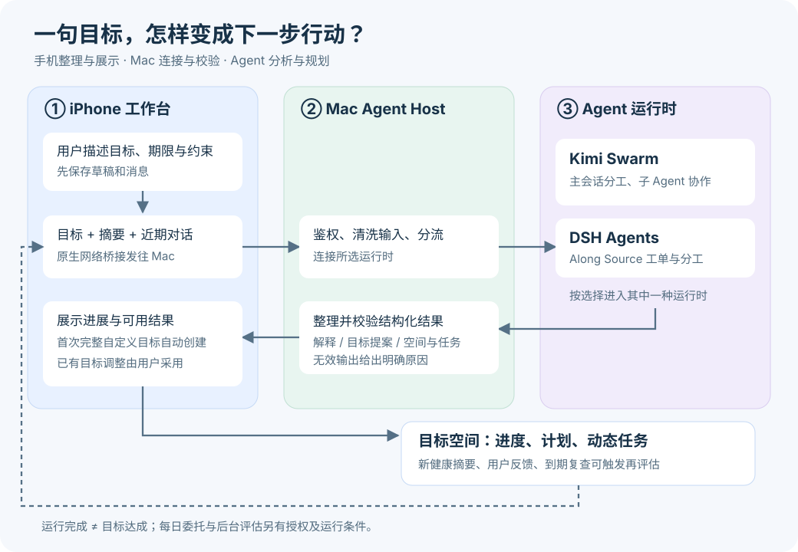
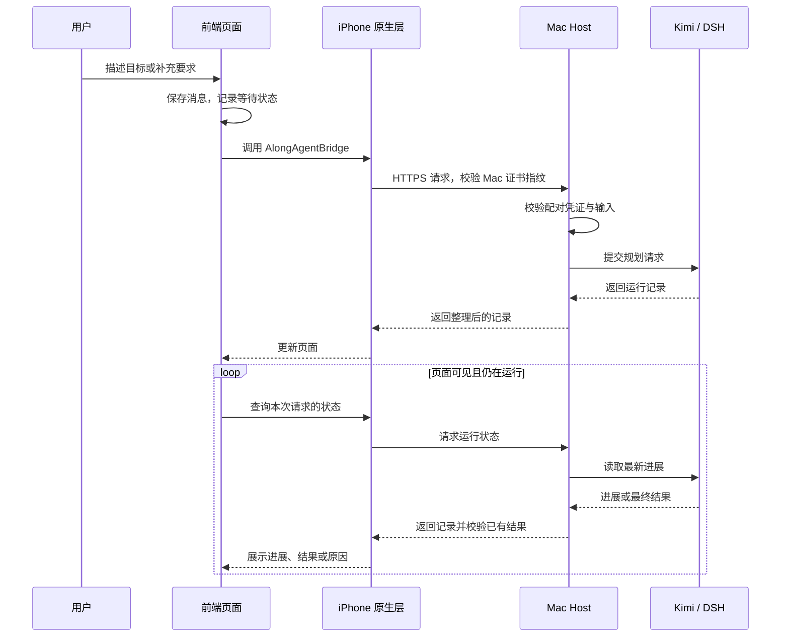
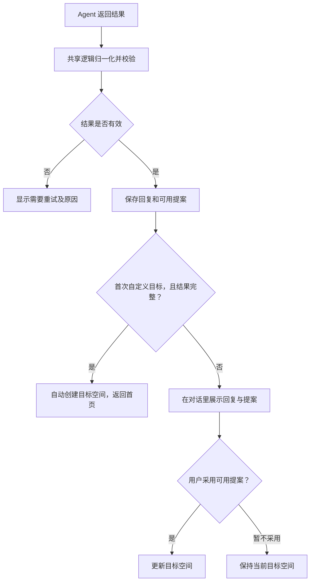
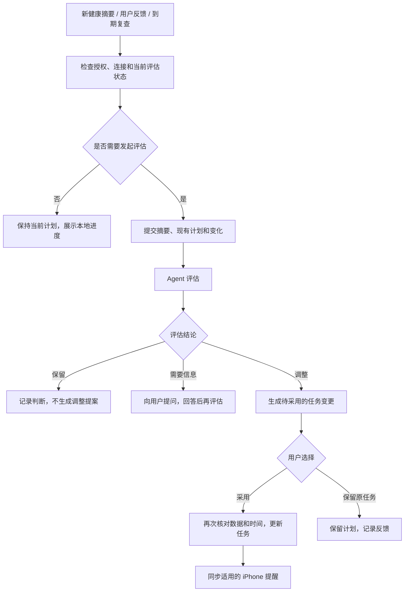

# Along 技术链路：从一句目标到下一步行动

> 2026-11-15 更新。新链路见下段；其余章节保留旧 Host 兼容路径说明，不能把其中的采用流程当作新架构行为。真实设备与 Agent 全链路验收仍须单独记录。

Host 配置 `ALONG_EVENT_INGEST=on` 且配置本机桥接凭证后，`/connection/status` 返回 `eventProtocol:1` 与绑定用户。App 切换到服务端拥有的目标空间：`agent-form` → `event-workspace.mjs` → 按用户隔离的持久事件队列 → Host `/events` → Along Agent Inbox → DSH 路由和 Along Worker 工具 → 校验后自动提交 → `/sync` 快照与持久对话 → 客户端整页校验、缓存提交 → `/sync/ack`。网络失败保留原事件号，ack 失败跨重启重试。目标只能通过聊天改变。

Worker 通过 `along_conversation_read` 读取库内原话，无目标的连续聊天也可读；现象描述调用 `along_chat_reply` 回应而不建目标，明确行动意图调用 `along_changes_commit` 创建目标与任务，再保存答复。纠正立即提升输入版本，服务端同时检查触发消息是否已经被后续原话取代，旧工作不能仅换成最新版本号继续提交。普通同步不触发系统通知。新链路不运行旧健康复评和采用处理器；健康持续跟进、记忆接线与批量调度另行实现。设计和验收见 [阶段 B](stage-b-tech-design.md)。

## 1. 先看全貌

Along 把用户的目标变成一个可以持续更新的工作台，代码里称为“目标空间”。里面有目标说明、进度、计划和动态任务。

**手机负责展示和保存，Mac 负责连接 Agent，Agent 负责分析与规划。** 健康进度等可以直接计算的内容由本地代码处理。

例如，用户说：“我想每周运动 120 分钟，工作日晚上比较空。”

1. Along 保存这句话，并整理当前目标和允许分享的数据。
2. Mac 把请求交给用户选定的 Agent。
3. Agent 给出解释、目标提案和下一步任务。
4. Along 校验结果，再按当前场景创建目标或等待用户采用。
5. 后续有新数据或新反馈时，再判断是否需要调整。

**Agent 编排完成，只代表这一轮分析结束，不代表用户的目标已经达成。**

## 2. 代码分别放在哪里

| 位置 | 可以把它理解为 | 主要工作 |
| --- | --- | --- |
| `web/` | 手机里看到的工作台 | 页面、目标、对话、进度、任务和本地状态 |
| `host/` | Mac 上的接线员 | 校验请求、连接 Kimi 或 DSH、整理结果 |
| `ios/AlongHealth/Sources/` | iPhone 的系统接口 | 健康数据、网络请求、连接凭证、通知与后台协作 |
| `test/` | 回归检查 | 检查协议、状态、页面交互和关键边界 |
| `tools/build.mjs` | 复制源码的构建脚本 | 把 `web/` 复制成网页和 App 内置页面 |
| `dist/`、`ios/AlongHealth/Web/` | 两份前端产物 | 分别供 GitHub Pages 和 iPhone 使用，不是独立源码 |

前端没有打包器。修改前端应改 `web/`，再通过构建生成产物。

## 3. 用户发出一句目标后，发生了什么

### 第一步：先保存用户写下的内容

点击“新建目标”后，前端创建一个独立的目标编号，例如 `custom:goal-…`，进入目标对话页。当前目标和对话会先保存在本机，避免等待 Agent 时重启导致内容丢失。

提交消息时，前端把下面几样东西放在一起：

| 字段 | 通俗解释 | 内容 |
| --- | --- | --- |
| `requestId` | 这次请求的编号 | 用来关联提交、查询和结果 |
| `goal` | 正在讨论什么目标 | 类型、标题和目标数值 |
| `snapshot` | 当前观察到的情况 | 健康目标的授权摘要、理财演示余额等；普通自定义目标的常规对话这里为空对象 |
| `message` | 用户这次说的话 | 目标、问题或补充要求 |
| `history` | 最近聊过什么 | 最多发送最近 12 条可分享的对话 |
| `runtime` | 交给谁处理 | Kimi 或 DSH |

页面的对话记录最多保留最近 20 条。发给 Agent 的历史只保留角色和文字，不是整个页面，也不是全部历史运行记录。

### 第二步：通过 iPhone 连接 Mac

真实请求走下面这条路径：

`web/agent-client.mjs` 依赖 iPhone 提供的 `AlongAgentBridge`。因此，普通浏览器可以展示演示页面，但当前代码不能直接从普通浏览器走这条真实 Agent 请求链路。

Mac Host 会检查目标类型、消息、摘要和请求编号，再按运行时分流。

### 第三步：Agent 分析并交付结果

| | Kimi Swarm | DSH Agents |
| --- | --- | --- |
| 连接对象 | Mac 本机 Kimi Code Web Server | 配置的 DSH Super Agent 服务 |
| 仓库内的主要实现 | `host/kimi-code-agent.mjs` | `host/agent-host.mjs` 中的代理路由 |
| 目标提交上游接口 | Kimi Sessions / Prompts API | `/along-source/api/goals` |
| 本仓库能确认的编排行为 | 创建会话、开启 Swarm、读取子 Agent 和综合结果 | 提交给 Along Source，读取工单、分工和运行记录 |

没有选择过运行时时，前端默认使用 Kimi；两种运行时的运行记录分开保存。

Kimi 普通目标请求的提示词要求主会话把工作分给至少三个真实子 Agent：分析目标、检查约束风险、设计动态任务，再综合结果。这个要求写在提示词里，不应当作每一次运行都已完成分工的证据，实际分工要看运行记录。

**Kimi 每次提交都会新建会话。** 聊天的连续性靠这次请求带入的近期历史维持。健康情境复评则允许主会话自行处理简单变化，仅在有需要时使用专家协作。

DSH 的完整内部实现不在本仓库中；这里能确认的是接口调用与结果消费方式。

### 第四步：把回复变成目标空间

Agent 的目标结果包含三个主要部分：

| 部分 | 用户看到什么 | 是否必需 |
| --- | --- | --- |
| `reply` | 对目标的解释或回答 | 必需 |
| `proposal` | 建议的目标标题、数值、下一步和理由 | 可为空 |
| `layout` | 目标空间的模块、任务、待确认问题和推荐连接 | 可为空 |

`layout` 是固定格式的数据，不是任意网页代码。前端只渲染允许的模块和任务类型。比如，用摘要卡解释计划，用事实列表列出约束，用动态任务显示下一步。

校验分为不同层次：Host 调用共享逻辑校验目标回复与布局；前端检查运行记录形状，并在写入布局时再次校验。关键函数是 `validateGoalReply`、`safeAdaptiveLayout` 和 `validateAdaptiveLayout`。

**当前实现有一处需要特别说明的差异：** 首次自定义目标在尚无目标和布局、结果同时包含有效提案、布局及至少一个任务时，会自动创建。已有目标的后续调整则通过“采用”生效。这与 README 和项目约定中“采用后生效”的统一描述存在差异，本文如实记录代码行为，并未修改它。

## 4. 目标建好后，怎样继续与 Agent 交互

目标对话、单个任务协作、健康复评是三条不同的路径。

| 路径 | 谁触发 | 提交什么 | 返回后怎样处理 |
| --- | --- | --- | --- |
| 目标对话 | 用户继续描述要求 | 目标、当前摘要、消息、近期历史 | 回复与目标空间提案；已有目标的调整等待采用 |
| 单个任务协作 | 用户打开任务详情；符合连接与授权条件时提交 | 该任务、目标和上下文 | 展示接单、协作单元、进展和报告 |
| 健康情境复评 | 健康观察变化、反馈或到期复查等 | 授权摘要、现有计划、变化和近期决策 | 保留原计划、提出变更，或询问缺失信息 |

常用接口对应如下。手机到 Host 的这些接口都使用 `POST`：

| 用途 | Host 接口 |
| --- | --- |
| 提交目标对话或情境复评 | `/super-agent/goals` |
| 查询目标或复评状态 | `/super-agent/goals/status` |
| 提交单个任务 | `/super-agent/tasks` |
| 查询单个任务状态 | `/super-agent/tasks/status` |

健康复评与普通聊天复用目标接口，但会携带 `snapshot.planning`，说明这是评估现有计划。**健康复评不能修改目标本身**，只能在约束内调整安排。

### 健康目标的持续调整

假设周目标是运动 120 分钟，当前已完成 75 分钟，本地代码可以直接算出还差 45 分钟。至于剩余时间怎样安排，要结合已有任务、用户反馈和授权数据交给 Agent 判断。

并非每次读取健康数据都会调用 Agent。前端会比较观察变化、目标要求、复查时间等条件；同一目标已有评估在运行时，不会直接再提交一份并行评估。

结果回来后，还要核对它对应的目标、数据和现有计划是否仍然有效。已经过时的结果不能直接采用；提醒时间已经过去时，也会要求重新评估。

这条自动观察链路目前主要围绕健康来源实现。普通自定义目标不能据此视为已经具备同样完整的自动追踪能力。

### 每日委托与通知

每日睡眠、运动安排有专门的 DSH 委托路径，需要用户明确委托，并核对目标、日期、时区和委托回执。它与普通待采用提案分别管理，不能套用成“所有安排都走同一个确认按钮”。

这里有三个不同的事实：

- Agent 选定了一个提醒时间：规划结果已经产生。
- iPhone 待发通知队列里有这条提醒：系统已经安排。
- 用户打开了通知：用户实际进行了打开操作。

前一项不能证明后一项。结果通知也需要通知权限及可执行的结果，并按请求编号去重；运行完成不一定会发通知。

## 5. 等待、失败和退出页面时会怎样

| 状态 | 含义 | 用户可以怎样理解 |
| --- | --- | --- |
| `working` | 正在提交、分析或综合 | 这一轮还没结束 |
| `done` | 运行完成 | 可以查看交付；不代表目标已经达成 |
| `blocked` | 连接、输出、会话或等待人工处理等问题阻碍继续 | 查看原因，按情况重试或去 Mac 处理 |

`actual: false` 是本地等待或失败记录，`actual: true` 表示拿到了真实运行记录；它同样不等于任务已完成。

- **目标对话状态**：前端可见且停留在目标对话页时，每 3 秒尝试查询仍在运行的目标。
- **任务详情状态**：停留在任务详情页且页面可见时，每 4 秒尝试查询。
- **健康复评状态**：页面可见时，每 3 秒尝试查询待处理复评。
- **健康刷新与复查**：前台约每 60 秒触发一次检查，最终是否调用 Agent 由条件判断。
- **读取失败**：保留原因；仍可等待的运行会继续查询，最长等待期限为 30 分钟。输出校验失败会落入明确的失败状态。

这是定时查询状态的交互，不是逐字推送回复。Kimi 界面上的部分进度百分比由会话状态和协作单元估算，不能理解为精确工时进度。

App 挂起后，网页定时器不能承担持续执行。健康后台评估有独立的原生路径，需要授权、iOS 唤起、健康摘要可读且配对 Mac 可达；回到前台再核对数据并取回结果。它不等同于全天候在线。

## 6. 状态和数据存在哪里

| 内容 | 位置 | 作用 |
| --- | --- | --- |
| 目标、对话、布局、前端运行记录 | 手机 WKWebView 的 `localStorage` | 恢复页面和当前工作状态 |
| 健康摘要、分享范围、评估状态 | 手机本地页面数据，按目标管理相关状态 | 计算进度，控制哪些信息可以参与评估 |
| 原生连接配置与配对凭证 | iPhone Keychain；前端也维护调用配置 | 恢复连接、鉴权 |
| 系统待发提醒 | iOS 通知系统 | 按已安排的时间提醒 |
| Host 证书、配对凭证哈希等 | Mac `~/.along/agent-host/` | 提供 HTTPS 与鉴权 |
| Kimi 请求与会话的关联 | 默认 `~/.along/agent-host/kimi-runs.json` | 用请求编号找回 Kimi 会话 |
| Agent 实际会话、工单和执行记录 | Kimi / DSH 各自的服务 | 提供真实运行状态 |

健康摘要会按授权范围发送给 Mac 和 Agent，不发送原始 HealthKit 样本。Kimi 的服务凭据留在 Mac，不传给手机，也不放入运行结果。手机持有的是与 Host 配对所需的凭证。

## 7. 当前能力边界

| 问题 | 当前情况 |
| --- | --- |
| Mac 关机还能用吗？ | 已保存页面和本地确定性进度仍可用；新的 Agent 对话、规划和状态读取依赖 Mac 与网络。 |
| Agent 会一直记得所有要求吗？ | Kimi 每轮新建会话，依赖请求带入的近期历史；健康复评另带目标要求和当前计划。不能当作无限长期记忆。 |
| 动态任务代表 Agent 已替用户做完了吗？ | 不代表。Kimi 的目标与任务提示词限定为规划，不允许外部写操作。DSH 内部执行能力需结合其服务与工单另行核实。 |
| 推荐一个连接，是否已经接上数据？ | 不代表。目标空间里的推荐连接只是建议，真实接入还需要对应能力与授权。 |
| 理财能操作真实账户吗？ | 不能。当前使用演示数据。 |
| 健康变化判断都一样吗？ | 不一样。真实情境复评使用 `contextual-planning.mjs`；旧实验与 `/goal/event` 还有独立的变化路由，不能把实验阈值套到所有路径。 |

## 8. 想继续看代码，从这些位置进入

下表是源码导航。查找函数名即可，不依赖容易变化的行号。

| 想了解什么 | 源码 | 入口 |
| --- | --- | --- |
| 新建草稿和目标聊天 | `web/app.mjs` | `beginNewGoal`、`goalAgentPage`、`submitSuperAgentGoal` |
| 结果进入对话、创建或更新空间 | `web/app.mjs` | `applyGoalRun`、`applyGeneratedGoal`、`accept-goal` 事件 |
| 首次自定义目标何时自动创建 | `web/adaptive-ui.mjs` | `findInitialCustomGoalCandidate` |
| 组装请求与运行记录 | `web/super-agent.mjs` | `createGoalSuperAgentRequest`、`safeGoalSuperAgentRun`、`withRunError` |
| 手机向 Mac 发请求 | `web/agent-client.mjs` | `agentCall` |
| Host 路由与 DSH 结果校验 | `host/agent-host.mjs` | `/super-agent/goals`、`normalizeGoalRun` |
| Kimi 分工、会话与结果收敛 | `host/kimi-code-agent.mjs` | `goalPrompt`、`start`、`status`、`goalResultFromOutput` |
| 目标和空间输出契约 | `web/goal-agent-core.mjs`、`web/adaptive-ui.mjs` | `validateGoalReply`、`validateAdaptiveLayout` |
| 任务协作 | `web/app.mjs` | `submitSuperAgentTask`、`refreshSuperAgentTask`、`taskDetailPage` |
| 健康复评与采用 | `web/app.mjs` | `createHealthReview` 内的 `reviewHealthContext`、`consumeHealthReview`、`accept` |
| 健康情境和变更校验 | `web/contextual-planning.mjs` | `createPlanningContext`、`validateReassessment` |
| 系统网络桥接、通知与证书校验 | `ios/AlongHealth/Sources/AlongShellView.swift` | `agentRequest`、`notificationOperation`、`PinnedAgentDelegate` |
| 结果通知去重 | `web/agent-notifications.mjs` | `goalRunNotification`、`taskRunNotification`、`notificationWasDelivered` |

产品运行与配置见仓库根目录 `README.md`，iPhone 安装与健康数据口径见 `ios/README.md`。本页的总览图是静态 SVG，细节流程使用 Mermaid，可在支持 Mermaid 的 Markdown 阅读器中查看。
