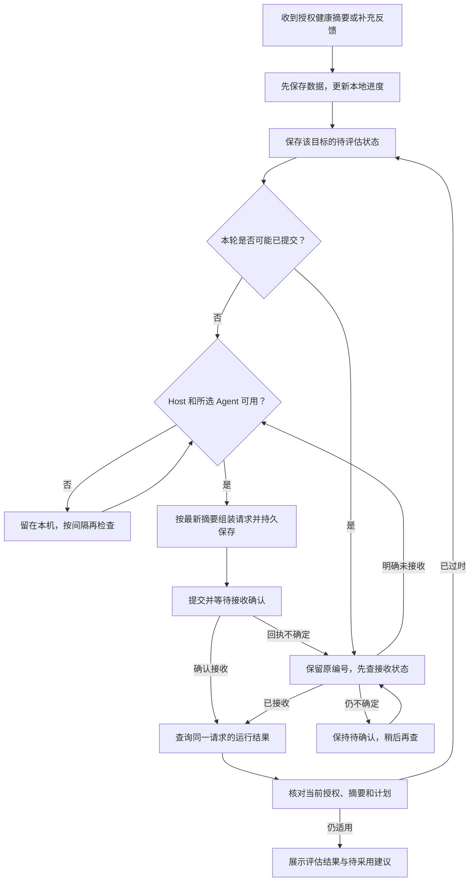

# 健康评估离线暂存与恢复方案

> 状态：待实现的方案草案。本文不代表功能已经上线。
>
> 根据 2026-11-14 的代码与本次讨论整理。现有技术链路见 [目标与 Agent 技术链路](goal-agent-flow.md)。

## 1. 要解决什么问题

手机已经收到了健康摘要，但手机断网、Mac 休眠、Host 未启动，或者 Agent 暂不可用。此时用户的数据和评估需求都应该留在手机上，服务恢复后继续处理。

**先保存在本机，恢复后按最新情况评估。** 本地进度照常更新，已有计划照常展示，不能让连接失败变成数据丢失或页面一直转圈。

这里的“服务恢复”包含整条链路可用：手机能连接 Host，Host 也能连接所选 Agent。仅能访问 Mac，不代表 Agent 已经可用。

### 本期建议范围

优先实现健康数据触发的自动评估，以及健康计划中的用户补充反馈。前台同时覆盖 Kimi 和 DSH；已有的 DSH 原生后台评估需要与前台沿用同一请求编号，并避免重复提交。

目标聊天和单个任务协作暂不自动补发。它们属于用户明确提交的独立消息或任务，不能直接套用“只保留最新健康摘要”的合并规则。后续若扩展，可复用接收确认和去重能力，但需要分别定义消息顺序与取消规则。

这是本方案建议的首期边界，尚未作为实现提交。

## 2. 用户会看到什么

| 场景 | 预期体验 |
| --- | --- |
| 健康数据更新，服务正常 | 更新进度，按现有条件发起评估 |
| 健康数据更新，服务不可用 | 更新进度；在已有评估提示位置显示“已保存在本机，连接恢复后评估” |
| 离线期间又有新数据 | 保留最新摘要，不堆出多张相同提示 |
| 连接恢复 | 自动继续处理，用户不用重新输入要求 |
| 用户选择“保留原任务” | 取消这一轮等待和结果提示，不再自动重发这一轮 |
| 结果已经过时 | 按最新情况重新评估，不让旧建议覆盖新进度 |

沿用现有卡片和“保留原任务”操作，不增加队列页面、配置开关或新的入口。连接恢复后的自动处理仍受健康授权和目标范围约束。

普通计划调整依旧经过校验并等待用户采用。已有每日委托的回执按原有授权规则处理，不能借补发扩大委托范围。

## 3. 整体流程

最重要的区别是：**“没有收到成功回复”不等于“服务端没有收到请求”。**

如果 Host 已经启动 Agent，只是回手机的响应丢了，直接再提交可能启动第二次评估。因此，本地暂存必须配合服务端接收确认与去重。

## 4. 手机上保存什么

不建立一个保存所有历史摘要的无限队列。每个健康目标最多维护：

- **一份最新待评估需求**：当前观察有变化、是否有尚未处理的反馈，以及重试时间等。
- **一份正在确认或执行的请求**：保留完整请求与固定编号，用于查回同一次运行。

已有健康摘要、目标与计划继续作为本机事实来源。请求真正发送前，再按最新授权范围整理需要分享的内容。

| 内容 | 为什么需要 |
| --- | --- |
| 目标编号 | 多个健康目标不能相互覆盖 |
| 运行时 | 原请求交给 Kimi，就不能去 DSH 查它 |
| 配对身份与授权范围标记 | 连接对象或授权改变后，旧请求不能继续外发 |
| 请求编号与当时的请求内容 | 回执丢失后查回原请求，重试时保持相同内容 |
| 投递状态、重试次数、下次尝试时间 | 重启后继续等待，避免高频循环 |
| 是否已有更新的数据或反馈 | 旧请求结束后，必要时再评估最新情况 |

待发送记录不额外保存 Token，不进入日志，也不发送原始 HealthKit 样本。凭证继续从现有连接配置读取；配对身份标记只用于检查当前连接是否仍是原来的连接。

### 怎样合并数据

假设服务离线期间，周运动分钟从 75 变成 85，再变成 100：

- 如果尚未提交，恢复后只按最新的 100 分钟发起评估。
- 如果 85 分钟的请求可能已经到达服务端，先查清该请求，不修改它的内容或编号；把 100 分钟标为后续待评估。
- 如果旧结果回来时数据已经变成 100 分钟，旧结果不进入可采用提案，再处理最新状态。

**用户补充的约束不能像健康数值一样直接覆盖丢弃。** 尚未处理的反馈需要保留到对应请求中；已尝试发送的反馈保留在原请求里，在它结束后再处理后续反馈。

## 5. 请求的几种状态

投递状态与 Agent 的 `working / done / blocked` 分开理解：前者描述有没有交到服务端，后者描述服务端怎样处理。

| 投递状态 | 含义 | 下一步 |
| --- | --- | --- |
| 待发送 | 已存本机，尚未尝试提交 | 等连接可用，按最新情况组装请求 |
| 接收待确认 | 请求已经尝试发出，但回执不确定 | 使用原编号查询，不能直接创建新请求 |
| 已接收 | 服务端明确记录了这一请求 | 查询同一运行；读取失败时继续保留 |
| 已结束 | 已得到有效结果，或确认本轮无法继续 | 展示结果或原因；有新变化时再开启下一轮 |
| 已取消 | 用户放弃本轮，或原授权范围失效 | 停止自动投递和采用本轮结果 |

发送前，先把请求内容与“接收待确认”状态一起持久保存。App 恰好退出时，重启后先查询这个编号。

对于尚未发送的需求，恢复时使用最新时间重新组装；对于已经尝试发送的请求，查询时保留原内容，不能把同一个编号换成新的摘要或时间。

## 6. 服务端怎样避免重复启动

Host 需要明确区分：**已接收、明确未接收、接收状态未知**。

建议为健康评估增加持久化接收记录，使用“配对身份 + 运行时 + 请求编号”识别请求，并核对请求内容：

1. 首次收到请求时，先持久保存接收记录，再调用上游。
2. 相同编号和相同内容再次到达时，返回已有状态或继续查询已有运行，不再新建一次编排。
3. 相同编号对应不同内容时，拒绝请求，避免结果串线。
4. Host 重启后，仍能根据接收记录查回原运行。
5. 并发收到同一编号时，也只能启动一次；不能只在请求完成后才缓存结果。

只有服务端能明确证明未接收、且旧请求不会再开始执行时，才允许重新投递。查询超时、连接错误或普通上游错误都不能当成“没有这条请求”。

### 必须补齐的上游边界

Host 保存“准备提交”之后，仍可能在调用上游时退出。此时 Host 知道有请求，却未必知道 Kimi 或 DSH 是否已经接收。

因此，需要分别核对两个运行时按请求编号去重、查询和恢复的能力，不能只加一份 Host 缓存就声称能可靠重试：

- **Kimi**：当前 `start` 每次都会创建新会话，需要补齐重复提交和中断恢复。会话已经创建但提示词回执丢失，也要能识别。
- **DSH**：本仓库是调用方。需要核实 Along Source 对同一请求编号的接收、去重和查询契约，再接入恢复流程。

如果上游暂时无法提供确定的恢复依据，相关请求保持“接收待确认”，给出原因；不能为了让队列继续而盲目重新启动。这是可靠自动补发的实现前提。

## 7. 什么时候尝试恢复

恢复检查入口包括：App 打开、回到前台、系统报告网络恢复，以及前台的定时检查。网络恢复事件只代表有网络，最终仍要验证 Host 和所选 Agent 可用。

建议失败后按 15 秒、30 秒、1 分钟、2 分钟逐步延长，最长间隔 5 分钟。间隔和尝试时间需要持久保存，避免重启后立即形成重试循环。无需向用户暴露这些配置。

同一目标只能有一次投递或恢复检查在进行。多个事件同时触发时共用这次检查；查询到已经接收的请求后，继续查结果，不重新提交。

| 问题 | 处理方式 |
| --- | --- |
| 手机断网、Host 无法连接、所选 Agent 暂不可用 | 保存在本机，按间隔恢复 |
| 提交或读取超时 | 保留原编号，先确认接收状态 |
| 配对失效、证书身份不符 | 暂停自动外发，沿用现有连接提示，让用户处理连接 |
| 输入不合法、模型输出校验失败、Agent 等待人工处理 | 给出明确原因，不作为断网请求无限重试 |
| 用户撤销评估授权、清数据或选择保留原任务 | 取消相应本地等待，不再补发这一轮 |

原生桥接目前主要把错误作为文字返回。实现时应保留错误类别、HTTP 状态和明确的未接收语义，避免仅凭错误文字决定是否重试。

### App 在后台时

iOS 不保证网页计时器持续运行，也不保证网络恢复后立即唤起 App。

- 普通前台暂存请求，至少在下次打开或回到前台时继续处理。
- 已获授权的 DSH 原生后台路径，在系统给出执行机会、摘要可读且连接可用时继续处理。
- 前台接管时先读取原生持久记录，查回同一次请求，不能前后台各建一张工单。
- 锁屏读不到数据时继续保留待处理标记，不把缺失读数解释成零。

因此，本方案承诺的是“保存并在有执行机会时恢复”，不是“恢复网络后一定立即完成”。

## 8. 恢复前与采用前，再检查一次

等待期间现实情况会变化，恢复不应机械重放旧操作：

- **健康摘要更新**：尚未提交的需求使用最新摘要；已接收的旧结果不覆盖新状态。
- **跨日或提醒时间已过**：重新按当前时间评估，不补排昨天的提醒。
- **授权缩小或撤销**：旧待发送内容失效；仅在仍有授权时按新范围重新整理需求。
- **目标、任务或计划变更**：旧结果失效，按当前计划复评。
- **运行时或配对身份变化**：停止旧请求的自动投递；不把旧请求转交给另一个运行时或另一台 Host。
- **用户取消本轮**：取消标记需要持久保存，重启或网络恢复不能把它复活。服务端已开始的分析不一定能撤回，但结果不能再自动进入待采用提案。

已有的结果校验、版本核对、授权检查与采用前时间检查继续保留。

## 9. 对现有实现需要改什么

现有代码已经保存健康摘要和 `planningState.request`，也有部分重连恢复逻辑；本期应尽量沿用这些状态，不另建一套互不相识的队列。

| 位置 | 当前能力 | 计划补齐 |
| --- | --- | --- |
| `web/app.mjs` | 保存健康摘要、请求和运行状态；部分重连恢复 | 持久化待发送与接收待确认状态，合并新观察，按间隔恢复，处理取消及授权变化 |
| `web/agent-client.mjs` 与原生桥接 | 通过 iPhone 发请求 | 保留可供重试判断的结构化错误与响应语义 |
| `host/agent-host.mjs` | 路由 Kimi / DSH，校验结果 | 持久化接收确认、同编号去重及状态查询语义 |
| `host/kimi-code-agent.mjs` | 创建会话、保存请求与会话关联 | 重复请求与启动中断的安全恢复 |
| DSH Along Source | 提供目标编排接口 | 核实并补齐接收去重与恢复契约，外部服务改动另行确认范围 |
| iOS 原生后台协调器 | 保存后台待处理标记和请求编号 | 与前台投递状态衔接，防止重复提交和取消后重发 |

实现不改变健康数据分享边界，不放宽 Agent 输出校验，也不自动采用普通计划调整。

## 10. 怎样算实现完成

| 验证场景 | 必须观察到的结果 |
| --- | --- |
| 服务离线时收到新健康摘要 | 本地进度更新，待评估状态落盘 |
| 离线期间多次更新 | 待发送需求合并，恢复后使用最新摘要 |
| App 退出再打开 | 等待状态仍在，恢复后继续处理 |
| Host 恢复，但 Agent 仍不可用 | 继续等待，不丢请求、不高频重试 |
| 提交已接收但成功回执丢失 | 查回同一次运行，没有第二次编排 |
| Host 在上游提交前后重启 | 能安全恢复；无法确认时保留待确认，不盲目重发 |
| 多个恢复事件同时发生 | 同一目标只执行一次恢复流程 |
| 离线期间用户补充约束 | 补充内容不会被摘要合并丢弃 |
| 等待期间跨日或计划变更 | 不展示可采用的过时建议，不安排过期提醒 |
| 撤权、清数据、取消本轮后重启 | 不补发已失效内容，不恢复已取消请求 |
| 原生后台已经提交，前台重新打开 | 使用同一编号取回结果，不重复提交 |
| 输入、输出校验失败 | 明确结束并保留原因，不当作断网反复尝试 |

验证应通过真实前端入口和 Host 适配层驱动，使用可控的网络、上游及生命周期替身覆盖中断位置。最后运行 `npm run check`，同步缓存版本并构建两份前端产物。

自动化检查之外，还需真机验证一次“Mac 离线 → 健康摘要更新 → App 重启 → Mac 恢复 → 取回评估”的完整过程。后台执行机会由 iOS 决定，需要单独观察，不能由前台测试替代。
